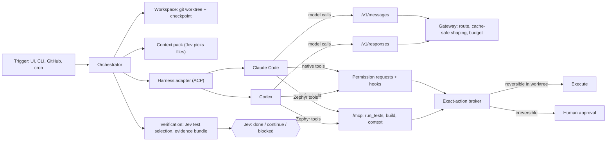

# Coding-agent control plane — design spec

Status: **draft**, 2026-10-30. Not implemented. Builds on
[agentos-design.md](agentos-design.md) (authoritative for privacy, permissions and
exact-action approval) and [backend-extension-plan.md](backend-extension-plan.md)
(Phase 1 reliability, Phase 4 harness-agnostic, Phase 5 triggers and decision cache).
Where this doc and the design spec disagree, the design spec wins.

## Goal

Zephyr runs Claude Code and Codex end to end — starts them, bounds them, watches every
model call and tool call, gates what they do, verifies what they produce — and makes
the same task **cost measurably fewer tokens** than running the agent on its own.

One sentence for the pitch: *your coding agent, supervised, verified, and cheaper because
of the supervision.*

Three things have to be true, in this order:

1. **Control.** Every model call goes through Zephyr's gateway, every tool call is
   classified and authorized, and the run is visible live on `/runs/:id`.
2. **Token reduction.** Measured against the same agent unsupervised on the same task
   set, with pass rate held equal or better. No unmeasured claims in the README.
3. **Verification.** A run ends with evidence (tests chosen and run, results, a diff,
   optional UI walkthrough), not with the agent's say-so.

## Non-goals

- Writing our own coding agent. Claude Code and Codex are the harnesses; Zephyr is the
  control plane around them.
- Proxying consumer subscriptions. Supervised mode routes model traffic through Zephyr,
  which needs API-key billing. Subscription users get Observed mode (below) only.
- Jev generating anything. Jev picks between options Zephyr builds (files, tests, routes,
  verdicts). If a design step needs a prompt for Jev, the design is wrong — see
  [jev.md](jev.md).
- Replacing CI. Zephyr chooses and runs a fast pre-merge subset; CI stays the
  authority on merge.

## Two modes

| | **Supervised** (full control) | **Observed** (zero-config) |
|---|---|---|
| Model traffic | Through Zephyr gateway (`/v1/messages`, `/v1/responses`) | Direct to vendor |
| Tool gating | ACP permission requests + hooks → broker | Hooks → broker (Claude Code only) |
| Token reduction | All levers (below) | Context pack + tool shaping + loop control only |
| Telemetry | Gateway accounting (exact) | Agent's OpenTelemetry export |
| Auth | User's API key, held by Zephyr | Whatever the user already uses |

Observed mode is the on-ramp: one settings snippet, and an existing Claude Code user sees
their sessions on `/runs`. Supervised mode is the product.

## Architecture



New pieces, by layer (dependency rule unchanged: `api → services → core`, providers
hold all SDK/subprocess code):

| Layer | New | Reuses |
|---|---|---|
| `providers/` | `claudecode/`, `codex/` harness adapters; `git/` workspace provider | ACP client code from `providers/hermes/live.ts` |
| `core/modelGateway/` | Anthropic Messages + OpenAI Responses surfaces; shaping pipeline | routing, tool stripping, per-turn tool budget, accounting |
| `core/tools/` | native-tool descriptors (`fs.*`, `shell.*`, `git.*`), shell command classifier, `run_tests`/`build` executors | broker, approval gate, registry |
| `core/verify/` (new) | test inventory, test-impact candidates, evidence bundle, protected paths | decision service (Jev + fallback) |
| `core/context/` (new) | repo index, context pack builder | Jev choice/score questions |
| `services/` | `workspaces.service`, `triggers.service`, `evidence.service` | runs, approvals, graphs |
| `api/` | `/api/hooks/:harness`, `/api/triggers/*`, `/v1/messages`, `/v1/responses` | stream, runs |

## 1. Control: harness adapters

### Choice of integration surface

Both agents expose more than one programmatic surface. Pick one primary per agent:

| Agent | Primary | Why | Fallback / extra |
|---|---|---|---|
| Claude Code | **ACP** via the Claude Code ACP adapter | Same transport as Hermes; the ACP client and session lifecycle already exist and are verified. Permission requests arrive as `session/request_permission`. | Claude Agent SDK in-process (`canUseTool`, hooks) if ACP lags SDK features. HTTP `PreToolUse` hooks as defence in depth in both cases. |
| Codex | **ACP** via the Codex ACP adapter | Same reason. | `codex app-server` (JSON-RPC over stdio, emits `item/commandExecution/requestApproval`). |

Generalize, don't copy: extract the transport/session/drain loop from
`providers/hermes/live.ts` into `providers/_acp/client.ts`; Hermes, Claude Code and Codex
become thin configs over it (binary, args, env, how to point at the gateway, how to
pass MCP servers). This is Phase 4 item 1 of the backend plan, done with three real
harnesses instead of one.

Contract change (additive, `packages/shared/src/providers.ts`):

```ts
interface AgentRuntimeAdapter {
  // ...existing startTask / pollTask / continueTask / cancelTask
  /** Native tool the harness wants to run. Must resolve to a broker decision. */
  onPermissionRequest?(
    req: NativeToolRequest,   // harness, tool name, raw input, session id
    ctx: ProviderCallContext,
  ): Promise<'allow' | 'deny' | { revise: unknown }>;
}
```

This replaces today's fail-closed `denyUnmappedHermesPermission`: unmapped still denies,
but `Bash`, `Edit`, `Write`, `Read`, `WebFetch` (and Codex's equivalents) now map to
trusted descriptors.

### Native tools become exact actions

The rule from the design spec holds: tool selection is not permission, and every exact
action is authorized independently. What changes is that a coding agent's native tools
get descriptors so the broker can reason about them.

| Native action | Descriptor | Reversibility | Default |
|---|---|---|---|
| Read/grep/glob inside the worktree | `fs.read` | n/a | auto |
| Edit/write inside the worktree | `fs.write` | **reversible** (git checkpoint) | auto |
| Read/write outside the worktree | `fs.*` | irreversible | deny (policy may allow read) |
| Shell: allow-listed read-only and test/build commands | `shell.exec` (class `inspect`/`verify`) | reversible | auto |
| Shell: package install, network, unknown binary | `shell.exec` (class `mutate_env`/`network`) | irreversible | approval |
| `git commit` in worktree | `git.commit` | reversible | auto |
| `git push`, PR create, merge | `git.publish` | **irreversible** | approval on exact payload (branch, diff hash) |
| Web fetch | `http.fetch` | read; egress-ledgered | policy |

Shell commands are classified by a deterministic parser (argv[0] + subcommand allowlist,
reject on `;`, `&&`, pipes into shells, redirects outside the worktree, `curl | sh`).
Anything the parser can't classify is `mutate_env` → approval. Jev is not asked whether a
shell command is safe.

Each harness turn starts with a **checkpoint** (`git stash create` / a commit on a shadow
ref). That's what makes in-worktree writes reversible, and it gives the UI a per-turn
"rewind to here" control.

### Belt and braces: hooks

For Claude Code, Zephyr also writes a per-run settings file with an HTTP `PreToolUse`
hook pointing at `POST /api/hooks/claudecode` (scoped token in the URL path, short TTL).
The hook endpoint calls the same broker path as `onPermissionRequest`. If either path
denies, the action is denied. In Observed mode the hook is the *only* control, which is
why Observed mode can't claim full control.

`PostToolUse` and `Stop` hooks feed the trace (`tool.lifecycle`, `harness.turn.ended`).

### Workspace

Each run gets a git worktree under `.data/workspaces/<runId>` on a branch
`zephyr/<runId>`. The harness subprocess runs with that as cwd, a scrubbed env (gateway
URL + scoped token, no ambient API keys), and Zephyr's MCP server as its only MCP
config. Cleanup on terminal status unless the run produced a branch the user kept.
Container/remote sandboxes are a later provider behind the same `workspace` capability.

## 2. Token reduction

Each lever is independently switchable per run (policy field) so the benchmark can
attribute savings. Ordered by expected payoff ÷ effort; payoffs are hypotheses until the
benchmark (section 5) says otherwise.

### L1. Shaped verification tools (high payoff, low effort)

The biggest single token sink in agent coding sessions is raw test/build/lint output fed
back into context, often repeatedly. Zephyr exposes MCP tools `zephyr.run_tests`,
`zephyr.build`, `zephyr.lint` that run the command in the worktree and return a
**structured digest**: counts, failing test ids, the first assertion and a trimmed stack
per failure, and a handle to fetch more (`zephyr.test_output(handle, testId)`).

The `PreToolUse` classifier recognises the raw equivalents (`pnpm test`, `pytest`,
`cargo test`, …) and denies them with a reason pointing at the shaped tool. The agent
adapts in one turn; the denial is a normal, logged broker decision.

Parsers: JUnit XML / TAP first (most runners emit one), raw-text fallback that keeps
only lines near `FAIL`/`Error`/`expected`.

### L2. Context pack (high payoff, medium effort)

Agents spend early turns exploring: listing directories, grepping, reading files that
turn out irrelevant. Before the first turn Zephyr builds a context pack:

1. Cheap deterministic candidates: files matching identifiers in the task, files
   touched by recent commits on related paths, imports of those, the test files that
   cover them. Capped at ~40 candidates.
2. **Jev scores each candidate** — one `score` question per file in a single request,
   state = task text + a one-line summary per file. Summaries come from a cached repo
   index (path, exports, symbols, first doc comment — deterministic, no model).
3. Top-k files (by score, above a threshold) go into the initial prompt as a compact map
   plus the full text of the top 2–3.

Fallback when Jev is unavailable: rank by the deterministic signals. Every pick is a
decision event with `source`.

### L3. Tool-schema minimization (medium payoff, low effort)

Every model call carries every tool definition. Zephyr already strips tool schemas the
Jev grant didn't select; extend that to the coding harnesses: pass `--strict-mcp-config`
(Claude Code) / an explicit MCP list (Codex), disable native tools the task class
doesn't need (no `WebFetch` for a pure refactor), and keep the granted set **stable for
the whole session** so prompt caching isn't invalidated mid-run.

### L4. Cache-safe gateway (protects all other savings)

Prompt caching is the largest existing discount, and a naive proxy destroys it. Rules
for the `/v1/messages` and `/v1/responses` surfaces:

- Forward `cache_control` breakpoints untouched; never reorder or rewrite the prefix.
- Redaction placeholders are deterministic per session (`[[PII_n]]` stable across
  turns), so redaction doesn't change bytes turn to turn.
- Any rewriting (L5) happens only at a **compaction point**, never on an ordinary turn.
- Account `cache_creation_input_tokens` and `cache_read_input_tokens` separately in the
  ledger; the Compare page shows cache hit rate, because a "savings" lever that lowers
  hit rate can cost more than it saves.

### L5. Stale tool-result elision at compaction (medium payoff, medium effort)

When context crosses a threshold, the agent compacts anyway (Claude Code auto-compact,
Codex equivalent). At that moment Zephyr may additionally replace tool results older
than N turns with their digest + handle. One cache miss, then a smaller stable prefix.
Off by default until measured.

### L6. Per-turn routing (medium payoff, needs care)

Jev's existing privacy × difficulty route decision, applied per harness turn: e.g.
small model for "run the shaped tests and report", frontier for "design the fix".
Constraint: switching model mid-session invalidates that model's cache, so routing is
per **node** (fresh session) by default, per turn only when the harness itself already
uses a secondary model (Claude Code's small-model calls go through the gateway and can be
routed independently).

### L7. Decompose into short sessions (high payoff, uses what exists)

Long single sessions pay to re-read their whole history every turn. The graph runtime
already supports `agent_task` nodes with explicit `contextInputs`. A coding workflow:

```
plan (frontier, read-only) → [implement step 1] → [implement step 2] → verify → fix-loop (bounded)
```

Each implement node is a **fresh** Claude Code/Codex session that receives only the
plan step, the context pack for that step and the previous node's digest. This is the
lever most likely to produce large savings and the one that most needs the benchmark to
show pass rate doesn't drop.

### L8. Loop control (prevents the worst-case runs)

- Per-turn tool budget (already in the gateway, default 8) applies to coding harnesses.
- **Stuck detection**: same failing test ids after K consecutive fix attempts, or the
  same file region edited and reverted → Jev completion question (`continue` /
  `blocked`); `blocked` pauses the run for a human instead of burning tokens.
- Token/cost budget per run (backend plan Phase 3.3) is enforced at the gateway:
  over budget → `blocked`, never silent continue.

### L9. Result caching across runs

Test results keyed by (test id, hash of files it covers) — unchanged tests aren't rerun
or re-reported. Context-pack decisions cached by (task hash, tree hash). Browser target
cache persists per origin (backend plan Phase 5 "decision cache").

## 3. Verification

### Test-impact selection

Candidates: tests whose covered files (from coverage maps when present, otherwise import
graph + path heuristics) intersect the diff, plus tests the policy marks always-run.
**Jev answers one `choice`-per-group or `score`-per-test request**: which of these are
relevant to this diff. Selected tests run via `zephyr.run_tests`; the full suite runs
before `git.publish` if policy says so. Fallback: run every candidate.

### Protected paths: the agent may not grade itself

Same principle as the optimizer stripping success checks. Policy declares protected
globs (default: test files the run didn't create, snapshots, CI config, lint config,
`*.lock`). Edits to them are classified **irreversible** → approval with the exact diff.
New test files are allowed and flagged in the evidence bundle.

### Evidence bundle

Every run that reaches `done` produces `evidence.json` + rendered summary:

- diff stat and diff hash; per-turn checkpoints
- tests selected (with Jev's scores and the fallback flag), results, before/after
- tests added/modified, protected-path approvals
- optional UI walkthrough: browser run against a preview URL using the existing local
  Chrome path; screenshots per step
- tokens (in / out / cache read / cache write), cost, wall time, versus the run's
  baseline if one exists
- egress ledger summary

`git.publish` attaches the rendered bundle to the PR body. The reviewer reads evidence
first and the diff second.

### Browser runs become regression tests

A walkthrough that passed has resolved targets in the target cache. Emit a Playwright
spec from that run (navigation + resolved selectors + assertions on the observed end
state) into the worktree as a proposed new test. Replays need no model call. This
closes the loop between "agent explored the UI" and "the repo has a test for it".

## 4. Triggers and scheduling

Depends on backend plan Phase 1 (queue, idempotency, approval persistence) — durable
runs are a prerequisite for unattended triggers, not a nice-to-have.

| Trigger | Fires | Default playbook |
|---|---|---|
| GitHub issue labeled `ready-for-agent` | webhook (HMAC) | `code_task`: worktree → context pack → implement → verify → PR (approval) |
| CI failed on a PR | webhook | `ci_fix`: reproduce with shaped tools → fix → verify; never pushes without approval |
| PR opened by a human | webhook | `verify_only`: test selection + evidence comment, no edits |
| Cron | tick | e.g. nightly flaky-test triage, weekly dependency upgrade |
| Manual | UI / `zephyr run "<task>"` CLI | any |

Each trigger carries a policy reference (budget, allowed harness, approval thresholds).
Approvals waiting on an unattended run notify via the Phase 1 webhook (Slack/phone are
consumers of that webhook, not new core features).

## 5. Measuring it: the benchmark

Nothing in this doc gets a number in the README until this runs. Extend
`services/benchmark.service.ts`:

- **Task set**: 20–40 real tasks from this repo's history and 1–2 other repos (bug fix
  with a failing test, small feature, refactor, CI fix). Each has a hidden acceptance
  test the agent never sees.
- **Arms**: (a) vanilla agent, same model, same prompt, no Zephyr; (b) Supervised with
  all levers; (c) leave-one-out arms for L1, L2, L5, L7 to attribute savings.
- **Metrics**: pass rate on hidden tests, input tokens, output tokens, cache read/write,
  cost, wall time, approvals requested, stuck-blocks. Medians and spread over ≥3 runs.
- **Bar**: report savings only where pass rate is within noise of (a) or better.
- The Compare page gets a "harness vs harness-under-Zephyr" view.

## 6. Jev usage (all choice/score, all with deterministic fallback)

| Decision | Question type | State | Fallback |
|---|---|---|---|
| Context-pack file relevance | `score` per file | task + file one-liners | deterministic rank |
| Test relevance | `score` per test / `choice` per group | diff summary + test names | run all candidates |
| Route per node/turn | existing route choice | sanitized task state | existing rule |
| Completion | `done`/`continue`/`blocked` | test digest, diff stat, turn count | rule on test status + budget |
| Stuck vs progressing | `choice` | last K digests | K identical digests → blocked |
| Flaky vs real failure | `probability` | failure history for that test id | treat as real |

Authorization never consults Jev.

## 7. UI

- `/runs/:id` gains a **Workspace** panel: live diff, per-turn checkpoints with rewind,
  shell commands with their classification, shaped test results.
- Token panel per turn: in/out/cache, with the lever that applied (e.g. "test output
  digested: 14k → 600 tokens").
- `/compare`: harness vs harness-under-Zephyr.
- Approval cards for `git.publish` and protected-path edits show the exact diff.

## 8. Phasing

| Phase | Scope | Done when |
|---|---|---|
| **A. Observed mode** (S–M) | HTTP hook endpoint, Claude Code settings generator, OTel ingest, runs of kind `external` (backend plan D10) | A normal Claude Code session appears live on `/runs/:id` with tool calls and token totals |
| **B. Supervised Claude Code** (M–L) | `_acp` extraction, Claude Code adapter, `/v1/messages` (streaming, cache-safe), native-tool descriptors + shell classifier, worktree + checkpoints | `pnpm check:claudecode` (mock ACP peer) green; live run edits a worktree, a `git push` pauses for approval |
| **C. Levers L1–L4 + benchmark** (M) | shaped tools, context pack, schema minimization, cache accounting; benchmark arms a/b/c | First measured numbers on the task set |
| **D. Verification** (M) | test-impact selection, protected paths, evidence bundle, PR attachment | A PR opened by Zephyr carries an evidence bundle |
| **E. Codex** (M) | Codex adapter, `/v1/responses` | Same checks as B against Codex |
| **F. Triggers** (M, after backend Phase 1) | GitHub webhooks, cron, CLI | Labeling an issue produces a verified PR awaiting approval |
| **G. L5–L9, browser→Playwright** (M–L) | remaining levers, regression emission | Benchmark shows attribution per lever |

Phase A first because it's small, works with any auth, and makes every later phase
debuggable. Phase C before D because token reduction is the headline.

## 9. Risks and open questions

- **Upstream churn.** Claude Code and Codex release often; ACP adapters can lag. Pin
  versions per release of Zephyr, contract-test against a mock ACP peer, and keep the
  Agent SDK / app-server fallbacks scoped.
- **Gateway fidelity.** `/v1/messages` must handle streaming, thinking blocks, tool use,
  `count_tokens`, and errors exactly, or the agent misbehaves in ways that look like
  agent bugs. Build a recorded-traffic replay test before going live.
- **Cache regressions.** Any shaping that touches the prefix can raise cost. L4's
  accounting is the guard; the benchmark is the judge.
- **Classifier gaps.** A shell classifier will miss things. It fails toward approval,
  and the worktree + scrubbed env limit blast radius, but it is not a sandbox. A
  container workspace provider is the real fix for untrusted tasks.
- **Windows.** The team develops on Windows; worktree paths, shell parsing (PowerShell vs
  bash) and process trees need explicit tests.
- **Open:** do we ship a `zephyr` CLI in Phase A (needed for "run my existing Claude Code
  through Zephyr" without the UI)? Recommendation: yes, thin, over the HTTP API.
- **Open:** licensing/ToS review for routing each vendor's agent through a third-party
  gateway with the user's own API key (expected fine; confirm per vendor).

## 10. Multi-agent coordination: the task board

The graph is what makes Zephyr more than a wrapper around one agent. A request becomes
a graph of tasks, the tasks run in parallel on different agents, and the user watches
and steers one board instead of N terminals.

Builds on what exists: a task board is a **view over a graph run** whose `agent_task`
nodes fan out (`core/swarm.ts` `fanOut`), with `core/locks.ts` `KeyedLock` for
serialized resources. No new execution engine.

### From one sentence to a board

1. The user types a request ("add team invites with email + an admin page").
2. The planner (frontier model, read-only, generative — the existing synthesizer) proposes
   tasks. Each has a title, an acceptance criterion, an **estimated write scope** (path
   globs) and dependencies.
3. Zephyr computes a conflict graph from the write scopes and groups tasks into waves:
   tasks whose scopes don't overlap run together.
4. The user reviews the board (split, merge, reorder, edit scope, pin an assignee) and
   presses **Run ready tasks**. Nothing runs before that on a fresh request.

### Leases: boundaries the broker enforces

Each running task holds a **write lease** over its globs.

- An edit outside the lease is denied by the broker with a reason. The agent can ask for
  an extension: granted automatically if no other lease overlaps, otherwise it is queued
  or sent for approval.
- **Hot files** (`package.json`, lockfiles, route registries, barrel `index.ts`, shared
  schemas) are never leased to an agent. Agents submit an **intent** instead
  ("add dependency `zod@3`", "register route `/invites`"). A serialized integrator step
  applies intents in order, so two agents never fight over the same line.
- Read access is unrestricted inside the repo.

This is the same mechanism that enforces boundaries between people (section 12).

### Routing: who does each task

For each ready task, Jev answers a `choice` over candidate assignees (Claude Code /
Codex × model tier, local model, or "needs a human"). State = task features (size, area,
has UI, scope) + each candidate's history on similar tasks (pass rate, median tokens,
current load). Fallback: rules (small → cheap tier; UI → the assignee with the most
active design preferences loaded; failing twice → escalate tier). Users can pin.

### Independent progress and merging

- Task states: `pending → ready → running → review → done`, plus `blocked` and `failed`.
  Each task owns its run, branch and worktree; events carry `taskId` so the board updates
  each card independently over SSE.
- Progress on a card is **derived by Zephyr** (tests passing, files changed, tokens,
  turns), not self-reported by the agent.
- Finished tasks enter a **merge queue**: rebase onto the integration branch, rerun the
  selected tests, attach evidence. A conflict or failure spawns a fix task back to the
  same agent with the conflict as context. Merging to `main` is `git.publish` →
  approval, or auto by policy when green.
- Stuck or over-budget tasks go to `blocked` with the reason and don't hold leases
  forever (leases expire and are re-requested on resume).

## 11. Learning loop: skills and preferences that improve with use

Every run produces signals about what the user wants. Zephyr turns them, in the
background and off the critical path, into **preferences** (short statements with
evidence) and **skills** (procedures), and loads the relevant ones into future tasks.
Agents get better at *this person's* idea of good, across projects.

### Two stores

| Store | Where | Holds | Applies |
|---|---|---|---|
| **Personal profile** | `~/.zephyr/profile.db` (SQLite, local by default) | design taste, code style, tooling habits, how they like reports; personal skills | every project this person works on |
| **Project knowledge** | `.zephyr/` in the repo, emitted as `.claude/skills/<name>/SKILL.md` and `AGENTS.md` sections | conventions, architecture notes, how to test this repo, recurring task recipes | everyone on the project, every harness |

Emitting to the harnesses' native formats means Claude Code and Codex use the knowledge
without Zephyr in the loop, and teammates review it in PRs like any other file.

### Signals, strongest first

1. **Edits the user makes to agent output** — the diff between what the agent produced
   and what got merged. The most honest signal there is.
2. **Picks between variants** — for UI work, the agent builds 2–3 variants, Zephyr
   screenshots each, the user picks one. Pairwise picks are the best way to learn taste.
3. **Rejected or revised approvals**, with the reason if given.
4. **Reverts** of agent commits within a few days.
5. **Explicit feedback** on a board card (thumbs, a comment).
6. **Wording in requests** ("less cluttered", "no new dependencies").

### Pipeline (per finished task, in the background)

1. Append signals to the signal log.
2. A normal model drafts candidate preferences or skill edits from the signals. This is
   generative work, so it is not Jev.
3. Jev scores each candidate: `probability` that the evidence supports it, and a `choice`
   against existing entries (new / duplicate of #k / contradicts #k).
4. Preferences gain confidence with evidence and go active above a threshold;
   contradicted ones retire. Every entry keeps links to its evidence.
5. **Personal** skills and preferences apply automatically, versioned, with one-click
   revert and a "What Zephyr learned" feed. **Project** skills are proposed as a PR
   (fork-don't-modify, same rule as the optimizer), because they change behavior for
   teammates.

### Using it, cheaply

At task start Jev `score`s each preference and skill for relevance to the task; the top-k
go into the context pack under a token cap. Loading only relevant skills is itself a
token lever — the alternative is a `CLAUDE.md` that grows forever and is sent on every
call.

### Guardrails

- Learned content never touches success checks, protected paths or policy, and never
  widens a permission. Learning can make the agent better; it cannot make it allowed.
- Learned skills are measured: a benchmark arm with and without them, and skills whose
  tasks' pass rate drops get demoted.
- The personal profile stays local. Signals from private-route runs are processed by a
  local model. Export and delete are one command. Personal preferences are never written
  into a repo unless the person promotes them.
- In shared code, project knowledge outranks personal taste.

## 12. Multiplayer sessions

Several people on one project board at once, each with their own agents, with Zephyr
keeping everyone out of each other's way. Needs auth and roles first (backend plan
Phase 3).

- **Room = project.** Members have roles: owner, maintainer, contributor, viewer.
- **Lanes.** Everyone sees the whole board. Each person creates tasks, claims them for
  themselves or their agents, and sees their own "Needs you" inbox.
- **Boundaries.** Leases (section 10) are held per person as well as per task. One
  person's agents can't edit inside another person's lease without that person's
  approval; the request goes to them, not to a shared queue.
- **Humans outside Zephyr.** A person editing in their own editor can't be blocked.
  An optional pre-push hook warns when their commits touch someone else's lease. This is
  advisory, and the doc says so.
- **Approvals by role.** Task approvals go to the task owner, merges to `main` to
  maintainers. Budgets per member.
- **Whose taste?** An agent working for Alice loads Alice's profile plus project
  knowledge.
- **Cheap first step:** a read-only share link to a board (spectator mode) needs no
  roles and covers "my teammate wants to watch".

## 13. Making it easy to use

- **One command:** `npx zephyr up` in a repo. It detects installed `claude` / `codex`
  binaries and keys, starts the server, opens the board.
- **Bring existing sessions:** one click installs the Observed-mode hook so the user's
  current Claude Code sessions show up before they change anything.
- **The home screen is "Needs you"**: every approval, blocked task, variant pick and
  review across all agents, in one list, oldest first. Desktop notification or a
  webhook for Slack.
- **Templates** for common flows: add a feature, fix CI, upgrade a dependency, polish UI.
- **Per-task summary** written from evidence (what changed, tests, cost), so the user
  doesn't read transcripts.
- **Sensible defaults**: policy, budgets and concurrency preset per template, each with a
  one-line explanation and an override.

## 14. Core versus later

**Core** — the demo story is *type a feature → board of tasks → agents work in parallel
inside boundaries → verified merges → Zephyr learned something → the next task is
better and cheaper*:

1. Supervised Claude Code execution (sections 1, phase B). Everything depends on it.
2. Task board: decomposition, leases, Jev routing, merge queue, "Needs you" inbox
   (sections 10, 13).
3. Learning v1: signals from edits, approvals and variant picks → personal preferences
   and skills, loaded by relevance (section 11).
4. Token levers L1, L2, L4 and the benchmark (sections 2, 5), plus the evidence bundle
   (section 3) — the proof that it is cheaper and that it works.

**Later**, in rough order: Codex adapter (phase E); triggers (section 4); project skills
as PRs; multiplayer with roles (section 12, after spectator mode); remaining token
levers; browser → Playwright; Zephyr as an MCP server; team-synced profiles; the
appendix items.

## 15. Parallel workstreams and the four-person split

Same method as the design spec's team split: **agree contracts first, ship a mock
behind each, then build in parallel.**

### Day 0 contracts (everyone, a few hours)

Additive zod schemas in `packages/shared`: `Task`, `TaskStatus`, `Assignee`, `Lease`,
`HotFileIntent`, `NativeToolRequest`, `PreferenceSignal`, `Preference`, `Skill`,
`SkillProposal`, `EvidenceBundle`, and the events `task.*`, `lease.*`, `learning.*`.
Each owner ships a deterministic mock so the board runs end to end on day 0.

### Workstreams

| Stream | What | Depends on (via contract only) |
|---|---|---|
| W1 Execution | ACP extraction, Claude Code then Codex adapters, gateway surfaces, worktrees, checkpoints, permission bridge | `authorize` from W3 |
| W2 Decisions & learning | Jev questions (routing, context pack, skill relevance, test selection, completion, stuck); learning pipeline and stores; benchmark | signals from W3/W4 |
| W3 Coordination & safety | task service and state machine, conflict graph and waves, leases and broker enforcement, hot-file intents, merge queue, native-tool descriptors, shell classifier, shaped test tools, protected paths, evidence | assignee from W2, runs from W1 |
| W4 Product surface | board, "Needs you" inbox, decomposition review, variant picker, learned feed, `zephyr up` CLI, Observed setup, compare page, spectator mode, demo | events from all |

### Who does what

Roles keep the existing owners' areas so nobody relearns a codebase.

| Owner | Owns | Files | Done when |
|---|---|---|---|
| **Person 1** — runtime and harness | W1. `providers/_acp` extraction; Claude Code adapter, then Codex; `/v1/messages` (streaming, cache-safe, cache accounting), then `/v1/responses`; worktree provider and per-turn checkpoints; `onPermissionRequest`; Observed-mode hook endpoint | `providers/_acp`, `providers/claudecode`, `providers/codex`, `providers/git`, `core/modelGateway`, `api/hooks.routes.ts` | A board task runs live Claude Code in its own worktree, every native tool call reaches the broker, a `git push` waits for approval |
| **Person 2** — Jev, routing, learning | W2. Assignee routing; context pack; skill/preference relevance; test selection; completion and stuck judge; signal log, candidate drafting, Jev scoring, `profile.db`, emitters to `.claude/skills` and `AGENTS.md`; benchmark arms incl. with/without learned skills | `core/decisions`, `core/context` (new), `core/learning` (new), `services/learning.service.ts`, `services/benchmark.service.ts` | After a user edits an agent's diff, a preference appears with evidence and the next relevant task loads it; benchmark reports tokens and pass rate |
| **Person 3** — tools, safety, coordination | W3. Native-tool descriptors and shell classifier; `zephyr.run_tests/build/lint` with digests; protected paths; task service, conflict graph and waves; leases and their broker check; hot-file intents and integrator; merge queue; evidence bundle assembly | `core/tools`, `core/verify` (new), `core/coordination` (new), `services/tasks.service.ts` | Three tasks run at once, an out-of-lease edit is denied, two `package.json` intents both land, the merge queue merges all three green |
| **Person 4** — product and demo | W4. Board with live cards; "Needs you" inbox; decomposition review and editing; variant picker (a signal source for Person 2); learned feed with revert; `zephyr up` CLI; Observed setup screen; compare page; spectator links; demo script | `apps/web`, `packages/cli` (new), `api/tasks.routes.ts`, `api/learning.routes.ts` | A new user goes from `npx zephyr up` to a running board in under five minutes, and every approval is reachable from the inbox |

### Milestones (shared)

| | Milestone | Proves |
|---|---|---|
| M1 | Contracts and mocks; the board runs on mocks | Everyone unblocked |
| M2 | One real Claude Code task end to end on the board | W1 + W3 + W4 integrate |
| M3 | Three parallel tasks with leases, intents and the merge queue | Coordination works |
| M4 | Edit → preference → next task uses it, visible in the learned feed | Learning works |
| M5 | Benchmark numbers, and the demo recorded on a real feature | It is cheaper, and it works |

Integration seams to watch: the permission bridge (P1 calls P3's lease check through the
broker), routing (P3's scheduler calls P2), and signals (P3's merge queue and P4's
variant picker both write to P2's signal log). Each is one function in `packages/shared`;
agree it on day 0 and don't change it without telling the other owner.

This section's order supersedes section 8 where they differ: board and learning move
ahead of Codex and triggers.

## Appendix: further directions

Not in scope above; candidates once phases A–D land.

1. **Adversarial test author.** A separate session (different model or harness) writes
   the acceptance tests from the issue *before* implementation; the implementer can't see
   or edit them. Directly attacks "the agent grades itself".
2. **Best-of-N in parallel worktrees.** N cheap-model attempts, verification picks the
   winner, frontier only on failure. Often cheaper than one frontier run; the benchmark
   decides.
3. **Learned policy suggestions.** Mine approval history for actions humans always
   approve and *propose* policy rules (a human accepts them; policy stays deterministic).
4. **Run-to-graph distillation.** Successful boards for recurring request types become
   reusable graph templates (skills and preferences are now section 11).
5. **Cost forecast before launch.** Jev scores task difficulty; with history, show an
   expected token range and let the user pick a budget before spending anything.
6. **Prompt-injection firewall on repo content.** Treat READMEs, issue bodies, fetched
   pages and dependency source as untrusted tool output: label, content-check, and never
   let them widen a grant.
7. **Team policy packs for code.** "No new dependencies without approval", "no edits
   under `infra/`", "frontier model only for `security/`" — Phase 3 policy records with a
   code-specific vocabulary.
8. **Remote runners.** Container sandboxes (local Docker first, hosted later) behind the
   `workspace` capability for untrusted repos and parallelism.
9. **Agent-to-agent handoff (deferred).** Expose Zephyr itself as an MCP server (`run_workflow`,
   `request_approval`, `verify_change`) so any agent can delegate to a supervised run.
10. **Non-code automations on the same engine.** Incident runbooks, back-office browser
    tasks on the private route, scheduled site audits (accessibility, broken flows).
